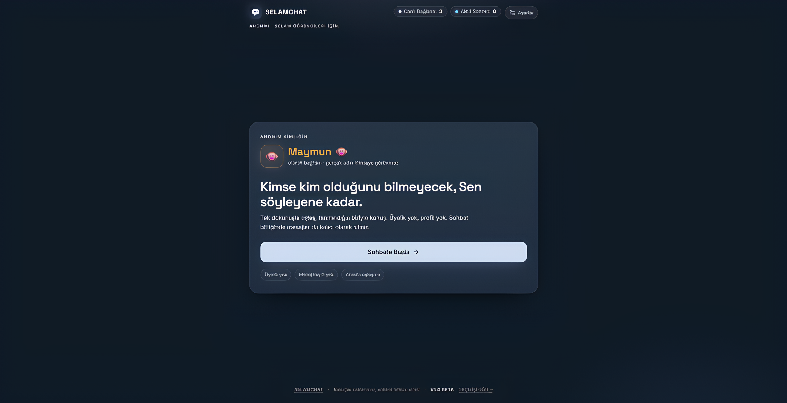

 <div align="center">

# SELAMCHAT

**Anonymous conversations. Real-time connections.**

A place to meet someone new. No accounts. No profiles. Just conversation.

[](https://selamchat.fun)
[](https://react.dev)
[](https://vite.dev)
[](https://www.typescriptlang.org)
[](https://expressjs.com)
[](https://www.mysql.com)
[](https://vercel.com)

[Website](https://selamchat.fun) · [Repository](https://github.com/karadayiefe/SELAMCHAT)

<br/>



</div>

---

## Overview

SELAMCHAT is an anonymous real-time chat platform that connects people through random matching.

No registration. No profiles. No complicated setup.

Just enter, get matched, and start a conversation.

## Features

| Feature | Description |
|---|---|
| **Anonymous Matching** | Meet someone new through random matching. |
| **Real-time Messaging** | Chat instantly with your matched partner. |
| **Temporary Identity** | Every session receives a random animal identity. |
| **Theme System** | Choose between different visual themes. |
| **Privacy Focused** | Conversations are not kept as permanent chat history. |
| **Automatic Cleanup** | Messages and session data are cleared when a conversation ends. |

---

## How It Works

<div align="center">

| 01 | 02 | 03 | 04 |
|:---:|:---:|:---:|:---:|
| **JOIN** | **MATCH** | **CHAT** | **LEAVE** |
| Enter the queue | Find a random partner | Start talking | End the session |

</div>

## Technology

<div align="center">

[](https://react.dev)
[](https://vite.dev)
[](https://www.typescriptlang.org)
[](https://expressjs.com)
[](https://orm.drizzle.team)
[](https://www.mysql.com)
[](https://vercel.com)

</div>

## Project Structure

```text
SELAMCHAT/
├── api/
├── client/
├── drizzle/
├── server/
├── shared/
├── package.json
└── README.md
```

## Links

- **Website:** https://selamchat.fun
- **GitHub:** https://github.com/karadayiefe/SELAMCHAT

---

<div align="center">

**SELAMCHAT**

*Made for conversations.*

[Website](https://selamchat.fun) · [GitHub](https://github.com/karadayiefe/SELAMCHAT)

</div>
