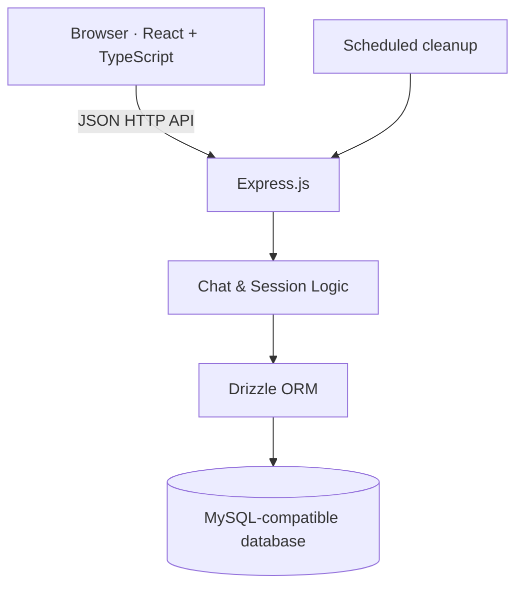

<div align="center">

# SELAMCHAT

**Anonymous conversations. Real-time connections. No accounts.**

Meet someone new. Start with a hello.

[](https://selamchat.fun)
[](https://react.dev/)
[](https://www.typescriptlang.org/)
[](https://vite.dev/)
[](https://pnpm.io/)

[Website](https://selamchat.fun) · [Features](#features) · [How It Works](#how-it-works) · [Architecture](#architecture) · [Run Locally](#run-locally) · [Privacy](#privacy)

<br />


<br />

*Less introduction. More conversation.*

</div>

---

## About

SELAMCHAT is an anonymous live chat platform that randomly pairs visitors for spontaneous one-to-one conversations.

There are no accounts to create, profiles to maintain, or lengthy onboarding steps. Each visitor receives a temporary animal identity, joins the matching queue, and can start talking when a connection is found.

## Features

| Feature | What it does |
|:--|:--|
| **Anonymous sessions** | Start chatting without registering or creating a public profile. |
| **Random matching** | Join a queue and get paired with another available visitor. |
| **Temporary animal identities** | Receive an automatically assigned animal name and visual identity. |
| **Live chat experience** | Send and receive messages, with delivery and read-state support. |
| **Presence awareness** | Track chat activity and visibility to handle disconnected or inactive sessions. |
| **Session cleanup** | Active room messages are removed when a conversation ends or an abandoned session is cleaned up. |
| **Custom themes** | Personalize the interface, including the Vice City theme. |

## How It Works

1. **Join** — Open SELAMCHAT and enter the matching queue.
2. **Match** — The server pairs you with another available visitor.
3. **Chat** — Exchange messages using temporary animal identities.
4. **Leave** — End the conversation whenever you want. The room is closed and its messages are cleaned up.

## Architecture

SELAMCHAT uses a React and TypeScript client, an Express server, and Drizzle ORM for MySQL-compatible database operations.



### Repository Structure

```text
SELAMCHAT/
├── api/              # Vercel API entry points
├── client/           # React application
│   ├── public/       # Static assets, themes and audio
│   └── src/          # UI, pages, hooks and chat client
├── drizzle/          # Database schema and migrations
├── patches/          # Package patches
├── server/           # Express routes and chat services
│   └── _core/        # Server setup and platform utilities
├── shared/           # Shared types and utilities
├── Dockerfile
├── package.json
├── pnpm-lock.yaml
├── vercel.json
└── README.md
```

## Technology Stack

| Technology | Role |
|:--|:--|
| React 19 | User interface |
| TypeScript 5.9 | Application language |
| Vite 7 | Frontend tooling and build |
| Express.js 4 | HTTP server and API |
| Drizzle ORM | Database access and schema |
| MySQL2 | MySQL-compatible database driver |
| Vitest | Automated tests |
| pnpm 10 | Package management |
| Vercel | Hosting and scheduled cleanup |

## Run Locally

### Requirements

- Node.js 22 or later
- Corepack
- A MySQL-compatible database for chat functionality

### 1. Clone the repository

```bash
git clone https://github.com/karadayiefe/SELAMCHAT.git
cd SELAMCHAT
```

### 2. Install dependencies

```bash
corepack enable
pnpm install
```

### 3. Configure the database

Set `DATABASE_URL` to your MySQL-compatible database connection string in your local environment.

### 4. Start development

```bash
pnpm dev
```

The development script uses `NODE_ENV=development`; on Windows, run it from a compatible shell such as Git Bash or WSL.

## Project Commands

| Command | Description |
|:--|:--|
| `pnpm dev` | Start the development server |
| `pnpm build` | Build the client and server |
| `pnpm build:static` | Build the static client for deployment |
| `pnpm start` | Run the production server |
| `pnpm check` | Run TypeScript checks |
| `pnpm test` | Run the Vitest test suite |
| `pnpm format` | Format project files |
| `pnpm db:migrate` | Apply database migrations |

## Privacy & Session Lifecycle

SELAMCHAT is designed around temporary, anonymous chat sessions.

- Visitors do not need to create an account or public profile.
- A random session token identifies a visitor during their session.
- Messages belong to an active chat room rather than a permanent chat history.
- When a participant leaves, the room is closed and its messages are deleted.
- If a connection disappears unexpectedly, inactive sessions are cleaned up through timeout handling and scheduled cleanup.

These behaviors describe the application's session lifecycle; they should not be interpreted as a claim of end-to-end encryption.

## Contributing & Feedback

Found a bug or have an idea?

- [Report a bug](https://github.com/karadayiefe/SELAMCHAT/issues/new)
- [Request a feature](https://github.com/karadayiefe/SELAMCHAT/issues/new)
- [Browse the source](https://github.com/karadayiefe/SELAMCHAT)

Clear reproduction steps and concise suggestions are always helpful.

---

<div align="center">

## SELAMCHAT

**A new conversation is one click away.**

[](https://selamchat.fun)

*Built for spontaneous connections.*

</div>
